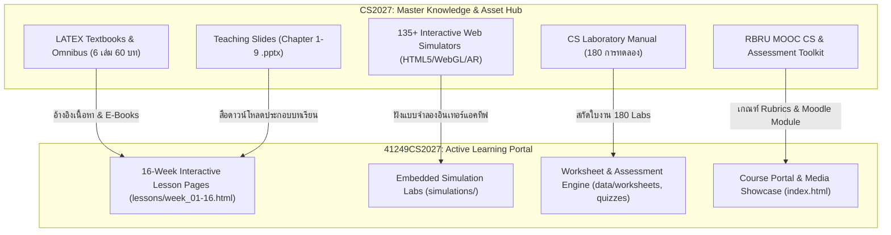
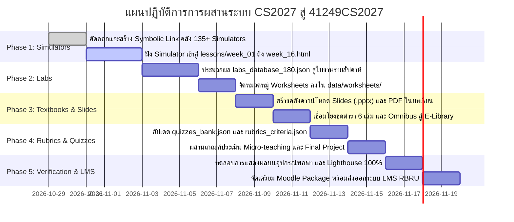

# แผนแม่บทการบูรณาการคลังทรัพยากรวิทยาการคำนวณ CS2027 เข้าสู่พอร์ทัลรายวิชา 4124941
## Master Implementation Plan: CS2027 Knowledge Hub to 41249CS2027 Active Courseware
**มหาวิทยาลัยราชภัฏรำไพพรรณี | คณะวิทยาศาสตร์และเทคโนโลยี | ภาควิชาฟิสิกส์และวิทยาศาสตร์ทั่วไป**  
**อาจารย์ผู้รับผิดชอบรายวิชาและผู้พัฒนา:** ผู้ช่วยศาสตราจารย์ ดร.ชีวะ ทัศนา

---

## 1. วิสัยทัศน์และวัตถุประสงค์เชิงยุทธศาสตร์ (Vision & Strategic Goals)

แผนแม่บทฉบับนี้จัดทำขึ้นเพื่อกำหนดทิศทาง กระบวนการ และแผนปฏิบัติการในการเชื่อมโยงและถ่ายโอนคลังทรัพยากรการเรียนรู้ขนาดใหญ่จาก **`CS2027`** (Master Computing Science Knowledge Hub) เข้าสู่ **`41249CS2027`** (Student-Facing Courseware Portal) รหัสวิชา **4124941 วิทยาการคำนวณสำหรับการสอนวิทยาศาสตร์** สำหรับนักศึกษาหลักสูตรครุศาสตรบัณฑิต สาขาวิชาวิทยาศาสตร์ทั่วไป (4 ปี)

### วัตถุประสงค์หลัก 4 ประการ:
1. **ยกระดับเป็น Active Learning Interactive Portal:** ให้นักศึกษาได้ลงมือปฏิบัติผ่านแบบจำลองเชิงโต้ตอบ (Interactive Simulators) ครบทุกสัปดาห์ ไม่ใช่เพียงการอ่านตัวหนังสือ
2. **บูรณาการศาสตร์การคิดเชิงคำนวณกับการสอนวิทยาศาสตร์ (Pedagogical Content Knowledge - PCK):** มุ่งเน้นการผลิต "ครูวิทยาศาสตร์" ที่สามารถนำวิทยาการคำนวณไปจัดกิจกรรมในโรงเรียนประถม-มัธยมได้อย่างเชี่ยวชาญ
3. **การประเมินผลตามสภาพจริง (Authentic Assessment & OBE):** สอดคล้องกับผลลัพธ์การเรียนรู้ระดับรายวิชา (CLO1–CLO4) และเกณฑ์ TQF 2567 ผ่านกระบวนการ Micro-teaching และ Capstone Project
4. **มาตรฐานผลงานทางวิชาการระดับสากล:** ถ่ายทอดองค์ความรู้จากชุดโครงการตำราวิชาการมาตรฐาน รองศาสตราจารย์ (รศ.) ของ ผศ.ดร.ชีวะ ทัศนา สู่มือผู้เรียนอย่างเป็นรูปธรรม

---

## 2. แผนผังความสอดคล้อง 16 สัปดาห์แบบไร้รอยต่อ (16-Week Curriculum Alignment Matrix)

| สัปดาห์ (Week) / Phase | สาระการเรียนรู้และหัวข้อหลัก (41249CS2027) | แหล่งตำราอ้างอิงใน CS2027 | สื่อ Simulator & Web Tools ที่นำมาฝังใช้งาน | การทดลองจาก 180 Labs ที่ตรงเป้าหมาย | สื่อสไลด์ (.pptx) / เอกสาร |
| :--- | :--- | :--- | :--- | :--- | :--- |
| **สัปดาห์ที่ 1** *(Phase 1)* | **ปฐมนิเทศ & แนวคิดเชิงคำนวณ 4 เสาหลัก** ความสำคัญของ CT ในวิทยาศาสตร์ | • Book 1 Ch 1-2 • CS_Vol1 Ch 1 | • `chapter01_decomposition_tree.html` • `chapter01_river_crossing.html` • `chapter01_unplugged_grid.html` | • Lab 001: ลอจิกเกมข้ามฝั่งแม่น้ำ • Lab 002: การวางแผนเส้นทางตารางเดินเรือ | • Chapter 1.pptx • Teachers Guide Ch 1 |
| **สัปดาห์ที่ 2** *(Phase 1)* | **การคิดเชิงนามธรรม (Abstraction) & Decomposition** การสกัดแบบจำลองและการแทนค่า 3D Voxel | • Book 1 Ch 3-4 • CS_Vol1 Ch 2 | • `simulations/voxel_lab.html` • `chapter01_abstraction_point_mass.html` • `chapter01_abstraction_sandbox.html` | • Lab 012: แบบจำลองจุดมวลฟิสิกส์ • Lab 015: การบีบอัดภาพ RLE สู่ 3D Voxel | • Chapter 2.pptx • Voxel Guide |
| **สัปดาห์ที่ 3** *(Phase 1)* | **การหารูปแบบ (Pattern) & การออกแบบอัลกอริทึม** การวิเคราะห์รูปแบบข้อมูลและขั้นตอนวิธีวิทย์ | • Book 1 Ch 5-6 • CS_Vol1 Ch 3 | • `chapter01_pattern_recognition.html` • `chapter01_pattern_explorer.html` • `chapter01_robot_grid_navigator.html` | • Lab 025: การตรวจจับแพทเทิร์นอุณหภูมิ • Lab 028: อัลกอริทึมค้นหาดาวเคราะห์ | • Chapter 3.pptx |
| **สัปดาห์ที่ 4** *(Phase 1)* | **รหัสลำลอง (Pseudocode) & ผังงาน (Flowchart)** การออกแบบขั้นตอนการทดลองและ Trace Table | • Book 1 Ch 7-8 • CS_Vol1 Ch 4 | • `chapter02_flowchart_builder.html` • `chapter02_pseudocode_ast.html` • `chapter02_trace_table_runner.html` | • Lab 034: ผังงานการไทเทรตกรด-เบส • Lab 037: ตารางไล่ค่าตัวแปรการตกอิสระ | • Chapter 4.pptx |
| **สัปดาห์ที่ 5** *(Phase 2)* | **การเขียนโปรแกรมอย่างง่าย 1 (ตัวแปร & เงื่อนไข)** Scratch สู่ Python: ตัวแปร ค่าคงที่ If-Else | • Book 2 & 3 Ch 1-3 • CS_Vol3 Ch 1 | • `chapter03_memory_model.html` • `chapter03_inbrowser_python_sandbox.html` • `chapter04_automated_decision_system.html` | • Lab 045: การคำนวณพลังงานจลน์ $E_k$ • Lab 050: ระบบแจ้งเตือนแผ่นดินไหว | • Chapter 5.pptx • Python Starter |
| **สัปดาห์ที่ 6** *(Phase 2)* | **การเขียนโปรแกรมอย่างง่าย 2 (ลูป & ฟังก์ชัน)** การวนซ้ำ สำหรับการประมวลผลข้อมูลวิทยาศาสตร์ | • Book 3 Ch 4-6 • CS_Vol3 Ch 2-3 | • `chapter04_for_loop_visualizer.html` • `chapter07_legb_scope_simulator.html` • `chapter08_matplotlib_2d_plotter.html` | • Lab 062: ลูปบันทึกข้อมูลการเจริญเติบโตพืช • Lab 068: ฟังก์ชันแปลงหน่วยอุณหภูมิ 3 สเกล | • Chapter 5.pptx (Part 2) |
| **สัปดาห์ที่ 7** *(Phase 2)* | **การตรวจหาข้อผิดพลาด (Debugging) & แบบจำลอง** เทคนิคกำจัด Bug และการสร้างแบบจำลองฟิสิกส์ | • Book 2 Ch 7 • CS_Vol2 Ch 4 | • `chapter07_refactoring_visualizer.html` • `chapter07_clean_code_visualizer.html` • `chapter08_3d_spring_oscillator.html` | • Lab 078: การแก้บั๊กสมการการเคลื่อนที่ • Lab 082: การจำลองการสั่นของสปริง 3D | • Chapter 6.pptx (Part 1) |
| **สัปดาห์ที่ 8** *(Phase 2)* | **การสอบกลางภาค (Midterm Examination)** วัดผลรวบยอดด้านพุทธิพิสัยและปฏิบัติการโค้ดดิ้ง | • รวมสรุป Book 1-3 • Syllabus Guide | • ระบบสอบออนไลน์ประมวลผลทันที • Interactive Code Challenge Sandbox | • ชุดข้อสอบปฏิบัติการกลางภาค (100 คะแนน แปลงสัดส่วน 20%) | • Midterm Exam Blueprint & Key |
| **สัปดาห์ที่ 9** *(Phase 3)* | **โครงงานวิทยาการคำนวณ 1 (Project Pitch)** การนำเสนอไอเดียแบบจำลองวิทย์ 3D/AI/IoT | • Book 4 Ch 1-3 • CS_Vol6 Ch 1 | • `chapter10_project_roadmap.html` • `chapter08_3d_projectile_cannon.html` • `chapter04_greenhouse_climate_controller.html` | • Lab 105: การจำลองวิถีโค้งกระสุนปืนใหญ่ • Lab 112: ตู้ควบคุมสภาพอากาศเรือนกระจก | • Chapter 6.pptx (Part 2) • Pitch Template |
| **สัปดาห์ที่ 10** *(Phase 3)* | **โครงงานวิทยาการคำนวณ 2 (Prototype Testing)** การทดสอบต้นแบบโปรแกรมและตรวจวัดความเที่ยงตรง | • Book 4 Ch 4-6 • CS_Vol6 Ch 2 | • `chapter08_wave_superposition.html` • `chapter09_mediapipe_vision.html` • `chapter09_edge_convolution.html` | • Lab 125: การซ้อนทับของคลื่นผิวน้ำ • Lab 130: การตรวจจับมือด้วย AI Computer Vision | • Prototype Review Matrix |
| **สัปดาห์ที่ 11** *(Phase 4)* | **การออกแบบแผนการจัดการเรียนรู้ (Lesson Plan)** การบูรณาการ CT เข้ากับ 5E และ CRAAP Test | • Book 4 Ch 7 • Teaching Docs 04 | • `chapter10_project_roadmap_generator.html` • `chapter07_csv_json_parser.html` | • Lab 142: โครงสร้างแผนการสอน 5E แบบบูรณาการ • Lab 145: แพลตฟอร์มคัดกรองข้อมูลวิทยาศาสตร์ | • Chapter 7.pptx • CRAAP Form |
| **สัปดาห์ที่ 12** *(Phase 4)* | **การผลิตสื่อการสอนและซ้อมสอน (Micro-teaching Prep)** การจัดทำใบงาน สื่อสาธิต และการซักซ้อมบทบาท | • Teaching Docs 01 & 04 • Omnibus Part 5 | • `chapter10_thesis_formatter.html` • `chapter08_matplotlib_2d_plotter.html` | • Lab 155: การออกแบบใบกิจกรรมการทดลองจำลอง • Lab 158: สื่อสไลด์ประกอบการสอนสาธิต | • Chapter 8.pptx • Micro Rehearsal Guide |
| **สัปดาห์ที่ 13** *(Phase 4)* | **การจุลการสอน 1 (Micro-teaching Round 1)** ปฏิบัติการสอนจริง 15 นาที ด้วยแบบจำลองวิทย์ | • Teaching Docs 04 • Assessment Toolkit | **นักศึกษาเลือกใช้ Simulator เป็นสื่อแกนกลาง:** • `chapter08_3d_projectile_cannon.html` • `chapter04_greenhouse_climate_controller.html` • `chapter07_heat_vs_temp_calorimeter.html` | • นักศึกษาประยุกต์ 1 แล็บจาก 180 Labs มาใช้จัดกิจกรรมการเรียนรู้ในชั้นเรียนจริง | • Chapter 9.pptx • Micro Rubric Round 1 |
| **สัปดาห์ที่ 14** *(Phase 4)* | **การจุลการสอน 2 & การสะท้อนคิด (AAR)** สอนซ่อมเสริมและกระบวนการพัฒนาต่อเนื่อง | • Assessment Toolkit • MOOC Vol 1 | • `chapter10_capstone_synthesizer.html` • `chapter07_refactoring_visualizer.html` | • Lab 168: ตารางสังเคราะห์ข้อเสนอแนะเพื่อนและอาจารย์ (Peer Feedback Matrix) | • AAR Protocol & Rubrics Round 2 |
| **สัปดาห์ที่ 15** *(Phase 4)* | **การจัดนิทรรศการโครงงานปลายภาค (Showcase)** การนำเสนอผลงานสื่อจำลองและการประเมิน 360° | • Omnibus Part 6 • 00_MASTER_COVERS | • `chapter10_innovation_gallery.html` • `chapter10_innovation_showcase_gallery.html` • `chapter10_poster_pitch_exam.html` | • Lab 175: การจัดทำโปสเตอร์วิชาการโครงงาน • Lab 178: การประเมินสมรรถนะแบบ 360 องศา | • Final Project Rubric (20%) |
| **สัปดาห์ที่ 16** *(Phase 4)* | **การสอบปลายภาค (Final Examination)** การประเมินรวบยอดผลลัพธ์การเรียนรู้ (CLO1–CLO4) | • คลังข้อสอบ CS2027 • Dossier Assoc. Prof | • `chapter10_code_security_scanner.html` • Comprehensive Exit Exam Online | • Lab 180: แบบทดสอบประมวลสมรรถนะครูวิทยาการคำนวณขั้นสูง (Exit Assessment) | • Comprehensive Exam Key (10%) |

---

## 3. แผนปฏิบัติการ 5 ระยะ (5-Phase Implementation Roadmap)

### ระยะที่ 1: การเชื่อมโยง Simulators และ Interactive Media เข้าสู่ Lessons Week 1–16
1. เชื่อมต่อหรือคัดลอกไฟล์ Simulators ที่จำเป็นจาก `CS2027/05_Code_and_Simulators/simulators/` เข้าสู่ `41249CS2027/simulations/`
2. อัปเดตไฟล์ `week_01.html` ถึง `week_16.html` ให้มีกล่อง **"ปฏิบัติการจำลองเสมือนจริง (Interactive Science Simulator)"** พร้อมแท็ก `<iframe>` และปุ่มเปิดขยายเต็มจอ (Full Screen Modal) เหมือนกับสัปดาห์ที่ 2 ที่มี `voxel_lab.html`
3. บันทึก URL ของแบบจำลองลงใน `course_manifest.json` ของแต่ละสัปดาห์

### ระยะที่ 2: การนำเข้าคลังใบปฏิบัติการ 180 การทดลอง (Worksheets Integration)
1. เขียนสคริปต์สกัดข้อมูลจาก `CS2027/CS_LABORATORY_MANUAL_180_EXPERIMENTS/labs_database_180.json`
2. จัดกลุ่มใบงานแล็บให้ตรงกับสัปดาห์ที่ 1–16 สัปดาห์ละ 2–3 กิจกรรม (กิจกรรม Plugged และ Unplugged)
3. สร้างหน้าแสดงผลใบงานดิจิทัลใน `41249CS2027/data/worksheets/` พร้อมฟังก์ชันพิมพ์ออกเป็น PDF มาตรฐาน

### ระยะที่ 3: การผสานสไลด์บรรยาย (.pptx) และชุดตำราวิชาการ (Textbook & E-Library)
1. นำไฟล์สไลด์ `Computing Science for Science Teaching - Chapter 1.pptx` ถึง `Chapter 9.pptx` เข้ามาติดตั้งใน `41249CS2027/assets/slides/`
2. เพิ่มปุ่ม **"ดาวน์โหลดสไลด์บรรยายประจำสัปดาห์"** ในหน้าบทเรียนที่เกี่ยวข้อง
3. นำเล่มตำราหลัก `computing_science_for_science_teaching_textbook_th.pdf` และชุดตำรา 6 เล่มมาตรฐาน รศ. มาสร้างแท็บ **"คลังตำราและเอกสารคำสอนวิชาการ (Academic E-Library)"** บนหน้า `index.html`

### ระยะที่ 4: การตั้งค่าระบบวัดผลและการประเมิน จุลการสอน (Assessment & Rubrics Engine)
1. นำข้อสอบจาก `computing_science_assessment_toolkit.md` ใน `CS2027` มาเติมเต็มใน `41249CS2027/data/quizzes_bank.json`
2. ปรับปรุง `rubrics_criteria.json` ให้มีเกณฑ์การประเมินที่ครอบคลุม 6 ด้านตาม `course_manifest.json`:
   - การมีส่วนร่วมและใบงานย่อย (10%)
   - การสอบกลางภาค (20%)
   - งานปฏิบัติการเขียนโปรแกรม Lab (20%)
   - แผนการสอนและจุลการสอน Micro-teaching (20%)
   - โครงงานปลายภาค (20%)
   - การสอบปลายภาค (10%)

### ระยะที่ 5: การทดสอบระบบ การปรับแต่ง Responsive และการเชื่อมต่อ RBRU Moodle
1. ทดสอบการแสดงผลบนสมาร์ทโฟน แท็บเล็ต และคอมพิวเตอร์ (Mobile-First Responsive Layout)
2. ตรวจสอบระบบฟอนต์ Sarabun และ Inter ให้แสดงผลคมชัดทุกเบราว์เซอร์
3. นำโค้ดโมดูลจาก `CS2027/RBRU_MOOC_CS_VOL1/moodle_export/` มาเตรียมพร้อมสำหรับนำขึ้นระบบ Moodle e-Learning ของมหาวิทยาลัยราชภัฏรำไพพรรณี

---

## 4. ดัชนีชี้วัดความสำเร็จและการประกันคุณภาพ (KPIs & Quality Assurance)

| มิติด้านคุณภาพ | ตัวชี้วัดความสำเร็จ (KPI) | เป้าหมายความสำเร็จ |
| :--- | :--- | :---: |
| **ความครอบคลุมหลักสูตร (Curriculum Coverage)** | สัดส่วนเนื้อหาใน 16 สัปดาห์ที่ตรงตาม มคอ.3 และมาตรฐาน TQF 2567 | **100%** |
| **การมีส่วนร่วมเชิงโต้ตอบ (Interactive Engagement)** | สัดส่วนของสัปดาห์ที่มีแบบจำลอง Simulator ให้ทดลองเล่นจริงในห้องเรียน | **16 / 16 สัปดาห์ (100%)** |
| **คลังทรัพยากรการเรียนรู้ (Learning Resources)** | จำนวนใบงานแล็บ สไลด์บรรยาย และตำราอ้างอิงที่เข้าถึงได้ผ่านระบบ | **180 แล็บ / 9 บทสไลด์ / 6 ตำรา** |
| **ประสิทธิภาพระบบ (System Performance)** | คะแนน Google Lighthouse (Performance, Accessibility, Best Practices) | **≥ 95 คะแนน** |
| **ความพึงพอใจและสมรรถนะผู้เรียน** | อัตราการผ่านการประเมินสมรรถนะครูวิทยาการคำนวณ (Exit Competency) | **≥ 85% ของนักศึกษาทั้งหมด** |

---
*แผนแม่บทฉบับนี้พร้อมนำไปปฏิบัติการพัฒนาและเชื่อมโยงระบบในลำดับถัดไปได้ทันที*

